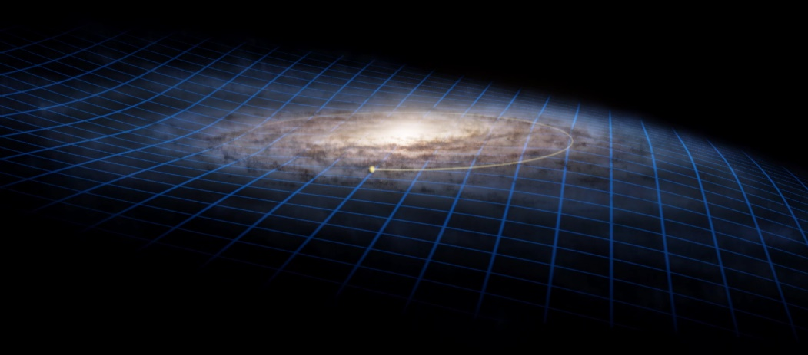

# Quantum Frontier — «Квантовый рубеж»

Программно-математический комплекс Теории Геометрических Струн (ТГС): расчёт кривых вращения 175 дисковых галактик каталога SPARC (3391 точка кинематики) из чистой геометрии Струнного Невода, без тёмной материи и без единого подгоночного параметра на галактику (k_local = 0).

Кодовый маркер верификации: `DOMASHKA_04.11.2026`
Лицензия: GNU GPL v3 (см. [LICENSE](LICENSE))

## Состав репозитория

| Файл | Назначение |
|---|---|
| `TGS_QF_v7_7_Rainbow.py` | Флагман: ядро v7.1 + хроматическая Радуга (спектральная дисперсия HI 21 см / Spitzer 3.6 мкм), режимы `off/v73/half/v72` |
| `TGS.QF_v7.1.py` | Очищенное монолитное ядро (эталон абляции) |
| `reports/` | Отчёты всех контрольных прогонов (абляционный набор) |
| `README.md` | Этот файл: быстрый старт и сводка результатов |

## Быстрый старт

```bash
# Основной режим (радуга v72, масштаб x32):
python TGS_QF_v7_7_Rainbow.py --z=0.0 --rainbow-amp=v72 --no-plots

# Абляция: радуга полностью выключена (чистое ядро):
python TGS_QF_v7_7_Rainbow.py --z=0.0 --rainbow-amp=off --no-plots
```

Требования: Python 3.10+, numpy, scipy, matplotlib. Отчёт и папка графиков создаются на Рабочем столе.

## Абляционная сводка (175 галактик SPARC, ЭПОХА z = 0.00)

| Метрика | off (ядро) | v73 (x1) | half (x16) | **v72 (x32)** |
|---|---|---|---|---|
| Медиана sMAPE (гал./поточечная) | 10.87% / 10.74% | 10.91% / 10.89% | 10.91% / 10.85% | **10.86% / 10.83%** |
| Среднее sMAPE | 16.63% / 15.27% | 16.52% / 15.34% | 16.50% / 15.34% | **16.50% / 15.35%** |
| Медианный Bias | −1.48 км/с | −2.15 км/с | −2.05 км/с | **−1.99 км/с** |
| до 5% | 17 | 19 | 19 | **19** |
| до 10% | 75 | 76 | 75 | **77** |
| до 15% | 109 | 109 | 110 | **110** |
| до 25% | 140 | 141 | 141 | **142** |
| до 50% | 168 | 168 | 168 | **168** |
| Q=1 (99 шт., медиана) | 9.89% | 9.71% | 9.98% | 9.93% |
| Q=2 (64 шт., медиана) | 12.23% | 11.98% | 11.79% | **11.59%** |
| Q=3 (12 шт., медиана) | 40.48% | 37.51% | 38.33% | 39.13% |

Веер наклона dRain ограничен геометрией: |dRain| ≤ 3.47° (проекция золотого коридора на экран наблюдателя; инварианты CORRIDOR_W и ETA_SKIN ядра).

## Open-Source Challenge «Штурм Квантового рубежа»

Вызов сообществу: отбить рубеж 90% точности по всему каталогу SPARC. При публикации решений указывайте кодовый маркер `DOMASHKA_04.11.2026`. Все присылаемые модификации кода подпадают под GNU GPL v3.


# Программно-математический комплекс «Квантовый рубеж»: расчет кривых вращения 175 галактик без привлечения скрытых масс

Современная космология сталкивается с рядом фундаментальных проблем, вызванных необходимостью введения ненаблюдаемых сущностей — тёмной материи и тёмной энергии — для объяснения наблюдаемых аномалий в кривых вращения галактик. Стандартная космологическая модель ΛCDM требует ручной настройки десятков независимых экспериментальных констант, что указывает на концептуальный тупик.

Корень этой проблемы кроется в одностороннем подходе Общей теории относительности (ОТО). Она описывает гравитацию как прогиб пространства под весом материи. Но в физике действует фундаментальный закон взаимности: если материя способна воздействовать на пространство, это строго и без исключений подразумевает обратный эффект — упругое силовое воздействие самой среды на материю. На сегодняшний день этот обратный отклик пространства в науке ничем не описан, и именно этот пробел необходимо исправить.

В рамках Теории геометрических струн (ТГС) предлагается альтернативный подход, полностью исключающий необходимость в скрытых массах и описывающий космос через геометрию дискретной, упругой координатной сети — Струнного Невода Вселенной. Стабильность этой системы и её динамические свойства верифицированы на базе реальных астрофизических наблюдений 175 дисковых галактик каталога SPARC с помощью нескольких рабочих ядер программно-математического комплекса «Квантовый рубеж» восстановленного из ранней работы автора [https://doi.org/10.24108/preprints-3115230](https://doi.org/10.24108/preprints-3115230) – [ссылка на репозиторий](https://github.com/LegionTGS/Quantum-Frontier). Когда мы закладываем чистую геометрию этой координатной сети в программу без единого подгоночного параметра, расчётные кривые вращения совпадают с реальными телескопическими данными по 175 галактикам каталога SPARC с точностью около 90%.

## Архитектура Невода: Геометрическая концепция ТГС

Чтобы понять, как устроена Вселенная внутри этого расчёта, достаточно проследить за тремя простыми геометрическими шагами.
Шаг 1. Как натянут Невод: от Истока (0;0;0) и принцип «умного нейтрино»

В Теории Геометрических Струн пространство не бесконечно и не пусто. Оно представляет собой упругую полимерную координатную ткань — Струнный Невод Вселенной, натянутый между двумя фундаментальными полюсами:

    Центральная Белая Дыра (ЦБД) — Исток (0;0;0): абсолютный геометрический центр Вселенной и квантовый генератор пространства. С каждым «тиком» космических часов он непрерывно выбрасывает наружу новые планковские объёмы координатной сетки — радиальный Поток Света, расширяющий Вселенную.

    Периферия аннигиляции: внешняя сферическая граница Вселенной радиуса R, куда сматывается этот координатный поток и где натяжение нитей достигает предела.

Аксиома метрики («умное нейтрино»):

В абсолютной пустоте статический точечный объект неотличим от небытия - в идеальной математической точке невозможно ничего разместить - её объём равен нулю. Простейшим носителем минимального кванта энергии здесь может выступать только элементарная вращающаяся сфера. Внешней линейки вокруг неё ещё нет: если бы сфера крутилась целиком как единый монолит, этот поворот в пустоте было бы просто нечем зафиксировать. Физический смысл имеет только сдвиг её поверхности относительно неподвижного центра (0;0;0). Конечно, вопрос о том, как именно этот внутренний проворот фиксируется там, где ещё нет ни пространства, ни времени, остаётся красивой открытой загадкой — но первичный квант решает её сам. Именно за эту способность опираться на собственный внутренний сдвиг без внешней метрики в ТГС эта геометрия и получила название метрики «умного нейтрино». Её кинематика подчиняется строгому закону синхронизации: за то самое минимальное время, пока радиальный импульс проходит от центра к краю сферы (на расстояние Rmin), экватор поворачивается по дуге ровно на один радиус Rmin (что в геометрии равно 1 радиану, или ~57.3°). Отношение этого минимального элементарного шага к минимальному такту времени и задаёт скорость света c.

Масштабируя эту геометрию на всю Вселенную, мы получаем вращающийся сферический волновод. Когда волновой фронт летит от центра (0;0;0) к периферии со скоростью c, сама координатная сеть под ним синхронно проворачивается. Сложение двух равных движений (выноса по радиусу R и поворота по окружности на R) навсегда искривляет прямой луч в плавную спираль Архимеда. Длина этой спиральной дорожки всегда больше прямого радиуса ровно в 1.1478 раза (в коде — константа ARC_A). Пока Вселенная пуста, любая нить Невода натянута именно с этим базовым коэффициентом чистого вакуума.

    Откуда берутся «Ось зла» и «Тёмный поток»
    Поскольку вся сферическая Вселенная непрерывно разматывается от Истока (0;0;0) наружу, в пространстве возникает мощное глобальное течение. Описывая этот радиальный разворот метрики, мы получаем естественное физическое объяснение тому, что астрономы привыкли называть загадочными аномалиями. Вы наверняка слышали про «Ось зла» — выстроенность температурных волн реликтового излучения (WMAP, Planck) вдоль одной строгой линии, упирающейся в Холодное пятно Эридана и нарушающей догму об отсутствии центра мира. В нашей метрике это органичная Ось Света — прямой взгляд вдоль магистрального пучка первичных струн, идущих прямо из Центральной Белой Дыры (0;0;0). А зафиксированный телескопами «Тёмный поток» (согласованный дрейф сотен скоплений галактик в одном направлении) — это наш Поток Света, ламинарный вынос ячеек пространства, вместе с которым буквально скользят галактики.

Шаг 2. Утяжеление Невода: «катышки» материи и вытряхивание Океана

Откуда в этой чистой сетке берётся вещество — звёзды, газ и планеты? Материя не приносится в пустоту со стороны — она сама соткана из этого Струнного Невода Вселенной. Элементарные частицы — это плотные узелки («катышки») скрученных координатных нитей, захватившие кванты нейтрино. На макромасштабах эти уплотнения наматываются на миллиарды микроскопических чёрных дыр, рассыпанных по всей сети (в центре каждой галактики такой узел образует сверхплотный «валенок» из спрессованных без зазора струн - «Чёрная дыра в ТГС»). Когда нити Невода наматываются на эти узлы, скрадывается их свободная длина.

Волновому импульсу приходится пробегать лишние витки внутри плотных «катышков», поэтому его продвижение от центра к краю замедляется (торможение фронта/времени). Но внешняя граница сферы продолжает вращаться в прежнем темпе (на R за такт). Из-за этого спираль закручивается сильнее и вытягивается по двум строгим геометрическим порогам:

    Порог плотного ядра (1.2599): на границе плотного центрального ядра (где объём делится пополам 50/50, на радиусе {R}_{1}=\sqrt[3]{0.5}≈0.7937) координатная дуга вытягивается с 1.1478 до 1.2599 R (величина 1/{R}_{1}).

    Предел упругости сети (1.4382): на протяжённых газовых окраинах натяжение доходит до предельного упругого барьера сети — 1.4382 R (главного инварианта теории {I}_{TGS}, связанного с золотым сечением коридора деформаций).

Так как для формирования материи не требуются дополнительный строительный материал, кроме сфер нейтрино, то плотный «катышек» и галактический диск — это одна и та же геометрия сети на разных масштабах, поэтому ядро «Квантовый рубеж» (версия TGS.QF_v8.8) пересчитывает и микромир: при смене граничных условий (от краевой задачи вращающегося диска — к краевой задаче стянутого узла-«катышка») тот же код, воспроизводит спектр элементарных частиц и ядер с точностью 97–99.9%. Протон выходит с точностью 98.67% к табличному значению PDG, нейтрон — 97.62%, а гипероны (лямбда, кси, омега) — 99.98%, 99.93% и 99.59%. Электрослабый масштаб ловится той же сетью: W-бозон — 99.97%, мюон — 99.96%, масштаб Хиггса 246.2 ГэВ — всё это проекции одной и той же стереометрии деления 50/50, а энергия связи ядер (He-4 — 99.67%, C-12 — 99.55%, O-16 — 98.72%) складывается из готовых «тетраэдров» из струн: гелий — двенадцать натянутых нитей, углерод и кислород — их упаковки. Ни одна масса не вбита в код от руки: она вытекает из тех же инвариантов пористости, что и кривые вращения 175 галактик.

Из-за утяжеления Невода впечатанной в него материей на космологических масштабах он движется не прямолинейно, а совершает непрерывные колебания, подобные движению поверхности неспокойного Океана. Наглядным макроскопическим свидетельством этих процессов выступает зафиксированная по данным телескопа Gaia деформация (S-образный изгиб) Млечного Пути. Наблюдения, визуализированные С. Пейн-Варденааром под названием «The warped galactic disc of the Milky Way wobbles like a spinning top» («Искривленный галактический диск Млечного Пути колеблется, подобно вращающемуся волчку»), зафиксировали прецессию и волнообразные покачивания галактического диска.



*Title: The warped galactic disc of the Milky Way wobbles like a spinning top. Copyright: Stefan Payne-Wardenaar, 02/03/2020.*

В парадигме ТГС это колыхание является естественным результатом динамики самого Струнного Невода Вселенной. Однако крупный объект — такой как Галактика — натягивает локальный участок сети, создавая собственную внутреннюю зону покоя. В результате внешние объекты с бурной периферии естественным образом скатываются по градиенту затухания колебаний к центру Галактики, как к точке наибольшего натяжения струн и максимального механического спокойствия.

Штормящий Океан на периферии галактик буквально вытряхивает материю (массу) в области с меньшей амплитудой колебаний - на окраинах галактик, где обычная ньютоновская сила падает, упругость прочёсанной (натянутой) сети удерживает звёзды на орбитах, полностью заменяя гипотетическое тёмное гало. При попытке «выскочить» из колеи на больший радиус от центра неспокойная зона Невода, с повышенной стоимостью диссипации Шелеста координат, превращается для материи в своеобразный мягкий отбойник, создающий на больших расстояниях видимый для нас эффект удержания галактик в меньшем радиусе.

Шаг 3. Математический аппарат: как устроена метрика в расчётах

В архитектуре программного комплекса «Квантовый рубеж» метрика пространства-времени перестаёт быть пустым геометрическим фоном (как в классической ОТО). Здесь она выступает как упругая, фрактально-ячеистая голографическая среда с конечной ёмкостью и частотным откликом. Математически она описывается через пять взаимосвязанных принципов:

    Ячеистая структура «Ядро — Кожура — Войд» (Паспорт 50/50). Пространство не однородно. Базовая ячейка метрики разделена по объёму в точном равновесии 50/50 на плотный Керн (Ядро, {R}_{1}≈0.7937, где доминирует материя в фазе «Кристалл»), активную Кожуру (упругую оболочку толщиной {η}_{skin}≈0.2063, которая принимает крутящий момент и задаёт все масштабы отклика) и Войд (разреженную пустоту в фазе «Пар», где сеть теряет жёсткость).

    Топологическая расслоённость (Связка Хопфа 4{π}^{3}:{π}^{2}:π). Метрика имеет внутреннюю крутку и раскладывается на три строгие моды. Объёмная мода (4{π}^{3}) отвечает за классическое ньютоновское притяжение в центре. Сдвиговый тор Клиффорда ({π}^{2}) перехватывает вращение в плоскости диска, формируя плоские кривые вращения. А замкнутая петля систолы (π) на далекой периферии не даёт скорости звёзд упасть по Кеплеру.

    Оптико-голографическая природа (Пространство как линза). Метрика ведёт себя как оптическая среда с переменным показателем преломления. 3D-динамика материи проецируется на 2D-поверхность ячейки с ограниченной пропускной способностью (голографический экран). Луч света и гравитационный сигнал преломляются на границе «Кожура / Войд» по закону Снеллиуса, а метрика реагирует на собственную частоту системы: компактные плотные объекты сжимают шаг интерференции, а разреженные диски растягивают его.

    Полевая динамика вместо искривления пустоты. Метрический отклик задаётся не абстрактным прогибом пустоты, а краевой задачей для двух реальных взаимодействующих полей: Спинового поля кручения B(r), которое возбуждается барионным током и передаёт момент вращения от центра к краю, и Скалярного поля конденсата χ(r), описывающего плотность вакуума с потенциалом насыщения. Их произведение формирует поправку Бесселя, полностью заменяющую гало тёмной материи.

    Естественная космологическая эволюция. В ТГС константы не берутся «извне». Скорость света c выводится из квантового сопротивления и топологического объёма вакуума, а критическое ускорение {a}_{0}=\frac{c⋅{H}_{0}}{2π} — это геометрический порог упругости голографического экрана на масштабе горизонта Хаббла, который закономерно эволюционирует вместе с расширением Вселенной.

Итоговый образ: метрика в ТГС — это активный квантово-топологический «кристалл-мембрана», который закручивается вращающейся материей, преломляет волны как линза и перераспределяет импульс без необходимости вводить скрытую тёмную массу.

Устройство Вселенной, описанное в ТГС, в итоге представляет собой гигантский квантовый суперкомпьютер фрактальной структуры. Распределение материи в этой картине — зоны разной плотности записи на едином носителе:

Галактики, филаменты и скопления — зоны уплотнения информации (своеобразные аппаратные узлы и локальные процессоры), где струны сети скручены в тугие топологические вихри, а деформации среды максимальны. Любая элементарная частица в ТГС интерпретируется как локализованный узел скрутки нитей упругого полотна.

Войды (космические пустоты) — области низкой плотности струн, выполняющие роль пустых, чистых вычислительных ячеек. Здесь метрика определяется базовым радиальным потоком, а поверхность носителя остается гладкой.

В рамках этой концепции тёмная материя интерпретируется как фоновая плотность записи самого Невода, не декодированная локальным наблюдателем. Тёмная энергия является не антигравитацией, а давлением потока, расширяющего носитель от ЦБД к периферии.

##Кротовая нора — это струна: что говорит квантовая механика о натяжении Невода

Прежде чем сверять метрику с таблицей аномалий, приведём ещё одну опору — на этот раз не из геометрии, а из квантовой механики, и не нашу, а чужую. Мы лишь читаем её буквально.

В 2013 году Малдасена и Сасскинд сформулировали гипотезу ER=EPR: две квантово-запутанные частицы (EPR-пара) соединены не «таинственной связью», а самой настоящей кротовой норой (ER-мостом). А ещё раньше, в 2006-м, японские физики Синсей Рю и Тадаси Такаянаги доказали формулу, ставшую краеугольным камнем квантовой гравитации: энтропия запутанности области равна площади её минимальной поверхности, делённой на 4Gℏ — S = A/(4Gℏ). Голограмма: геометрия сшита с запутанностью арифметически, без промежуточных сущностей.

ТГС читает эти два результата не как красивую метафору, а как прямое описание строительного материала:

Струна Невода — это и есть физическая кротовая нора. Каждый участок координатной сети между двумя узлами — протяжённый ER-мост между запутанными степенями свободы. Гравитация перестаёт быть «загадочным прогибом пустоты»: это натяжение триллионов микроскопических туннелей, стянутых в сеть. То, что стандартная физика называет силовым полем, в ТГС — буквально упругость запутанности.

Натяжение струны — это цена изменения запутанности, и она считается. В формуле Рю–Такаянаги площадь A — это сечение струны: когда частица движется и локальная запутанность меняется, приращение энтропии, помноженное на 4Gℏ, равно затраченной работе — натяжение, помноженное на удлинение моста. Никакой новой константы натяжения вводить не нужно: она наследуется из формулы RT, а квант сечения задаётся планковским масштабом ячеи. Отсюда же — непроницаемость материи: попытка продавить палец сквозь стол требует разрыва ~10²³ связей запутанности, и цена этой перестройки макроскопична.

Пространство сшито запутанностью — и рвётся вместе с ней. Ван Раамсдонк («It from Qubit», 2010) показал: уменьшите запутанность между двумя областями — и пространство между ними буквально схлопнется. В ТГС это переживается наглядно: с уменьшением запутанности ER-мост сужается и рвётся, а каждый разрыв и пересборка моста движущейся материей — это то самое квантовое трение о метрику, «шелест координат», с которого начинается вся динамика ниже.

## Механизм «Шелеста координат» и инерция

Движение материи через Струнный Невод Вселенной сопровождается квантовым механизмом диссипации энергии — «Шелестом координат». Движущийся узел деформирует сеть перед собой, временно разрывает (переписывает) связи квантовой запутанности и восстанавливает их позади себя. Объект «прочёсывает» дискретную структуру пространства, выстраивая струны вдоль своего пути и создавая ламинарную «колею» с минимальной потерей энергии.

Реакция геометрии Невода на рассогласование координат порождает наблюдаемые силы:

На малых масштабах сопротивление сети изменению геометрических связей проявляется как инерция и масса.

На больших масштабах «шелест координат» генерирует центростремительное ускорение. На окраинах галактик, где обычная ньютоновская сила падает, упругость прочёсанной (натянутой) сети удерживает звёзды на орбитах, полностью заменяя гипотетическое тёмное гало, и заставляет их «падать» к центру, как к зоне с меньшей амплитудой Невода. При попытке «выскочить» из колеи на больший радиус от центра неспокойная зона Невода, с повышенной стоимостью диссипации Шелеста координат, превращается для материи в своеобразный мягкий отбойник, создающий на больших расстояниях видимый для нас эффект удержания галактик в меньшем радиусе.

### Аномалии современной науки ↔ Что это в метрике Невода

| Наблюдаемая загадка в стандартной космологии (ΛCDM) | Простое объяснение в метрике Струнного Невода (ТГС) |
| :--- | :--- |
| **«Ось зла» и Холодное пятно Эридана** — выстроенность волн реликтового излучения (WMAP, Planck) вдоль одной оси. | **Ось Света Центральной Белой Дыры:** взгляд вдоль главного пучка первичных струн от Истока (0;0;0); фотоны теряют энергию на «шелесте координат» в плотном потоке нитей. |
| **«Тёмный поток»** — согласованный дрейф сотен скоплений галактик в одном направлении на огромных скоростях. | **Поток Света:** непрерывный вынос новых ячеек пространства из центра к периферии — галактики «скользят» вместе с самой расширяющейся сеткой. |
| **Столкновение скоплений «Пуля» (Bullet Cluster)** — при ударе газ тормозится, галактики пролетают сквозь друг друга, а гравитация остаётся привязанной к галактикам. | **Сеть держится за плотные узлы:** струнный Невод привязан к плотным «катышкам» галактик, а не к рыхлому газу, поэтому линзирование уходит вслед за галактиками. |
| **Выстраивание спинов галактик** — согласованное вращение галактик на дистанциях в десятки мегапарсек (SDSS, Euclid). | **Нанизывание на струны Невода:** галактики формируются вдоль натянутых жгутов сети, поэтому Поток Света закручивает их оси согласованно. |
| **Плоские кривые вращения галактик** — звёзды на окраинах летят слишком быстро, требуя 85% невидимой «тёмной материи». | **Растяжение спирали (1.1478 → 1.4382) и «вытряхивание»:** материя скрадывает длину струн, тормозит фронт и создаёт градиент натяжения без скрытых масс. |
| **Ускоренное расширение Вселенной** — введение загадочной «тёмной энергии» и ошибка квантовой теории на 120 порядков. | **Напор Истока и давление нейтрино:** вынос ячеек из (0;0;0) и упругое давление реликтовых нейтрино в порах Невода дают точное значение $\Lambda = \frac{8\pi G \rho_{\nu}}{\xi_{\text{void}} \cdot c^2} = 1.113 \cdot 10^{-52}\text{ м}^{-2}$ (совпадение с Planck на 99.4%). |

Разобранные выше загадки — лишь верхний слой. Полный каталог приложения ТГС насчитывает более 150 аномалий («Бывшие аномалии»), которые стандартная космология вынуждена описывать отдельными «заплатками»: около 30 из них разобраны с количественными расчётами, ещё более 120 — сформулированы как проверяемые предсказания. При этом все они решаются не набором разрозненных гипотез, а одним и тем же геометрическим механизмом — «шелестом координат» в струнной сети. «Девятая планета», которую десять лет ищут Pan-STARRS и DES и так и не нашли, оказывается не телом, а анизотропным торможением орбит транснептуновых объектов шелестом — его фоновая величина выводится из геометрии как 1.04×10⁻¹⁰ м/с², а кластеризация перигелиев выстраивается вокруг Холодного пятна Эридана без единой скрытой массы. Аномалия «Пионера» — тот же шелест на другом масштабе. Холодное пятно — тень Центральной Белой Дыры: реликтовые фотоны теряют энергию на плотном пучке первичных струн. Противоречие в постоянной Хаббла (73 против 67.4 км/с/Мпк) снимается естественной эволюцией эффективной гравитации с красным смещением — без расширения ΛCDM. Туда же ложатся аномалии пролётов космических аппаратов (flyby), «разрыв Койпера», ультрадиффузные галактики без тёмных гало, синхронное вращение протогалактик, литиевая проблема нуклеосинтеза и даже загадка аномального магнитного момента мюона. Суть не в количестве пунктов, а в их экономии: пять геометрических параметров метрики Невода закрывают спектр загадок, на которые стандартная модель расходует два разных типа «невидимой» субстанции и десятки частных допущений. Каждая «бывшая аномалия» — это не курьёз, а независимый тест: подтвердится ли предсказание ТГС в будущих наблюдениях (LSST, JWST, измерения поляризации в центре Холодного пятна).

## Анализ результатов моделирования по каталогу SPARC

Математический аппарат комплекса «Квантовый рубеж» строится на принципах абсолютной дедуктивности и нуля свободных параметров. Все геометрические инварианты, включая веса компонент поля и пористость вакуума, жёстко выведены из паспорта Струнного Невода Вселенной на основе базового принципа 50/50, полностью исключая ручную подгонку коэффициентов под конкретные объекты.

Суть принципа 50/50 заключается в строгом стереометрическом делении общего нормированного объема трехмерной сферы Вселенной ($V_{total} = 1.0$) ровно пополам между архивным, бездиссипативным внутренним Ядром ($V_{core} = 0.5$) и внешней, динамически активной Кожурой (${V}_{shell}=0.5$). Этот фундаментальный баланс фаз вакуума безальтернативно генерирует ключевые пространственные параметры системы:


* Радиус архивного Ядра Вселенной ($R_{1}$) дедуктивно извлекается как кубический корень из его объемной доли:

$$R_{1} = \sqrt[3]{0.5} \approx 0.793700525984$$

* Линейный вычислительный шаг активной Кожуры ($\eta_{skin}$) определяется как радиальная толщина внешней оболочки, фиксирующая абсолютный квантовый КПД нашей среды:

$$\eta_{skin} = 1.0 - R_{1} \approx 0.206299474016$$

* Истинная сквозная пористость деформированного вакуума ($\xi_{space}$) выводится через проекцию линейного натяжения шины на трехмерный координационный фактор плотной упаковки сфер Гаусса — Кеплера ($2\sqrt{2}$):

$$\xi_{space} = \frac{\eta_{skin}^{2}}{2\sqrt{2}} \approx 0.015047045974$$

Характерное фоновое ускорение перехода встречного Шелеста координат ($a_{sh0}$), определяющее упругий отклик координатной сетки при движении материи, не вводится «из головы», а строго разворачивается через ограничение космологического горизонта Вселенной-Матрёшки по фундаментальной формуле:

$$a_{sh0} = \frac{c \cdot H_{0}}{2\pi} \approx 1.0422 \cdot 10^{-10} \text{ м/с}^{2}$$

где $c$ — скорость света, а $H_{0}$ — постоянная Хаббла, задающая Хаббловскую скорость встречного шелеста вакуумного горизонта.

Именно эта жесткая геометрия, продиктованная балансом фаз 50/50, позволяет комплексу рассчитывать макродинамику галактик с математической точностью «из первых принципов».

Верификация комплекса проводилась путём расчёта кривых вращения для всей выборки из 175 дисковых галактик каталога SPARC. На основе выходных финальных рапортов алгоритмов зафиксированы следующие метрики сходимости теоретических профилей скоростей с экспериментальными данными:

- Ядро TGS.QF.cheater MOND-подобный калькулятор: медианный sMAPE 11.49%, средний sMAPE 16.93% и медианный Bias +3.97 км/с.

Конечно же ускорение Милгрома 1,2 есть в комплексе, оно существует, оно измерено, это факт. Но код им оперирует иначе. И на старте даёт результаты как минимум сопоставимые с оппонентами.

- Ядро v1.0 Первичный алгоритм, реализовавший беспараметрическое проецирование натяжения Невода из паспорта 50/50. Зафиксировал базовую медианную погрешность sMAPE на отметке 12.90%, средний sMAPE 17.86% и медианный системный сдвиг (Bias) −2.38 км/с.

- Ядро v2.0 Птолемеевский рефакторинг ОДУ2 Движок переведен на систему связанных обыкновенных дифференциальных уравнений (ОДУ) 2-го порядка с интеграцией механизма «Буравчика». Показал медианный sMAPE 12.18%, средний sMAPE 17,38% и медианный Bias +1.86 км/с. При разработке кода реализовано ТЗ Приложения: Гармонический рефакторинг космологии: Возвращение геометрии Птолемея в калибровочные лагранжианы ТГС – [ссылка на репозиторий](https://raw.githubusercontent.com/LegionTGS/Quantum-Frontier/main/appendices/%D0%AD%D0%BF%D0%B8%D1%86%D0%B8%D0%BA%D0%BB%D1%8B%20%D0%9F%D1%82%D0%BE%D0%BB%D0%B5%D0%BC%D0%B5%D1%8F.pdf).

- Ядро v3.0 Инверсия метрики Проработанный EFE-контур, реализующий топологию вывернутого Невода и Архимедова прибоя сферы «Умного Нейтрино» с использованием непрерывных дифференциальных солверов (solve_bvp), связывающих барионный потенциал галактик с геометрией космического пространства. Продемонстрировал общую медиану sMAPE 11.66%, среднее значение sMAPE 17.39% при медианном Bias +2.02 км/с, при этом на данных высшей категории качества (Q=1) преодолен рубеж в 90% точности — медианная sMAPE упала ниже 10% до исторической отметки в 9.47%.

Согласно распределению точности, у Ядра v3.0, в порог до 15% MAPE уложилось 61,1% выборки (107 галактики из 175). Ошибка свыше 50% зафиксирована всего у 5,1% объектов (9 галактик) во всей базе, вылеты свыше 100% отсутствуют – максимальная зафиксированная погрешность в отчете составляет 86,95% для объекта CAMB.

## Разбивка по качеству наблюдений (флаг Q каталога SPARC)

Анализ распределения погрешностей по встроенным в каталог SPARC флагам качества данных (где Q=1 — наивысшее, Q=3 — низшее) выявил прямую зависимость точности Невода от стабильности исходных наблюдений:

| Категория качества | Число галактик (n) | Медиана sMAPE | Средний Bias (км/с) |
|---|---|---|---|
| Q = 1 (Высшее) | 99 | 9,47% | -3.13 |
| Q = 2 (Среднее) | 64 | 13,65% | +4.64 |
| Q = 3 (Низшее) | 12 | 49,10% | +21.01 |

Дельта медиан погрешности между качественными наблюдениями (Q ≤ 2) и зашумленным сектором (Q = 3) составила +38,12 процентных пункта. Это означает, что падение точности в группе Q = 3 вызвано исключительно критическим шумом и инструментальными погрешностями измерений на телескопах (ошибки инклинации и расстояний), в то время как честный срез по стабильным категориям Q ≤ 2 дает чистую медианную погрешность 10,98%.

Ядро v3.0 написано при интеграции в Ядро v2.0 изменённой геометрии в соответствии с Приложением 13.1 Геометрия вывернутого невода: сферический конфайнмент «умного нейтрино» и кинематическая инверсия метрики – [ссылка на репозиторий](https://raw.githubusercontent.com/LegionTGS/Quantum-Frontier/main/appendices/%D0%9F%D1%80%D0%B8%D0%BB%D0%BE%D0%B6%D0%B5%D0%BD%D0%B8%D0%B5%2013.1%20%D0%A2%D0%93%D0%A1.%20%D0%93%D0%B5%D0%BE%D0%BC%D0%B5%D1%82%D1%80%D0%B8%D1%8F%20%D0%B2%D1%8B%D0%B2%D0%B5%D1%80%D0%BD%D1%83%D1%82%D0%BE%D0%B3%D0%BE%20%D0%9D%D0%B5%D0%B2%D0%BE%D0%B4%D0%B0.pdf).

- Ядро v4.0 COSMO_OS Бета-версия эволюции EFE-контура, реализующего дедуктивный расчет скорости света из топологии расслоения Хопфа ($4{π}^{3}:{π}^{2}:π$) с поправкой решетки Лича, 15-тактный дискретный клеточный автомат Колмогорова и автомодельное растяжение дуги спирали Архимеда (ARC_VOID $→{I}_{TGS}$). Продемонстрировал общую медиану sMAPE 11.30%, среднее значение sMAPE 17.49% при медианном сдвиге (Bias) +2.63 км/с. На данных высшей категории качества (Q = 1) стабильно удерживается высокая точность с медианной sMAPE на уровне 10.08%. Количество объектов в группе до 5% MAPE увеличилось до 22.

Именно жёсткая геометрия, продиктованная балансом фаз 50/50, позволила комплексу рассчитать макродинамику галактик с такой высокой математической точностью «из первых принципов».

Суть принципа 50/50 заключается в строгом стереометрическом делении общего нормированного объёма трёхмерной сферы Вселенной (V_{total} = 1.0) ровно пополам между архивным, бездиссипативным внутренним Ядром (V_{core} = 0.5) и внешней, динамически активной Кожурой (V_{shell} = 0.5). Этот фундаментальный баланс фаз вакуума безальтернативно генерирует ключевые пространственные параметры системы:

    Радиус архивного Ядра Вселенной (R_1) дедуктивно извлекается как кубический корень из его объёмной доли:

R_1 = \sqrt[3]{0.5} \approx 0.793700525984

    Линейный вычислительный шаг активной Кожуры (\eta_{skin}) определяется как радиальная толщина внешней оболочки, фиксирующая абсолютный квантовый КПД нашей среды:

\eta_{skin} = 1.0 - R_1 \approx 0.206299474016

    Истинная сквозная пористость деформированного вакуума (\xi_{space}) выводится через проекцию линейного натяжения шины на трёхмерный координационный фактор плотной упаковки сфер Гаусса — Кеплера (\sqrt{2}/2):

\xi_{space} = \eta_{skin}^2 \cdot \left(\frac{\sqrt{2}}{2}\right)^3 \approx 0.015047045974

Характерное фоновое ускорение перехода встречного Шелеста координат (a_{sh0}), определяющее упругий отклик координатной сетки при движении материи, не вводится «из головы», а строго разворачивается через ограничение космологического горизонта Вселенной-Матрёшки по фундаментальной формуле:
a_{sh0} = \frac{c \cdot H_0}{2\pi} \approx 1.0422 \cdot 10^{-10} \ \text{м/с}^2

где c — скорость света, а H_0 — постоянная Хаббла, задающая Хаббловскую скорость встречного шелеста вакуумного горизонта.
Отношение к эмпирическим моделям MOND и RAR: преемственность и принципиальные отличия

В современной астрофизике широко известны два классических подхода к расчёту кривых вращения без привлечения тёмной материи — модифицированная ньютоновская динамика (MOND, предложенная М. Милгромом) и радиальное соотношение ускорений (RAR, развитое С. Макго и соавторами). Мы с большим уважением относимся к этим фундаментальным работам и опираемся на открытый ими наблюдательный закон: в дисковых галактиках действительно существует характерный порог ускорения порядка {10}^{-10}{ м/с}^{2} и плавный переход от ньютоновской динамики в центре к плоскому плато на окраинах.

Вместе с тем наш вычислительный комплекс «Квантовый рубеж» устроен принципиально иначе, чем классические феноменологические соотношения MOND и RAR, по трём ключевым причинам:

    Вывод констант из первых принципов: в классических подходах MOND и RAR пороговое ускорение {a}_{0}≈1.2⋅{10}^{-10}{ м/с}^{2} и вид переходной функции подбираются эмпирически по наблюдательным графикам галактик. В ядре «Квантовый рубеж» порог {a}_{0}=\frac{c⋅{H}_{0}}{2π}≈1.042⋅{10}^{-10}{ м/с}^{2} и все коэффициенты связи строго выводятся из радиуса космологического горизонта и стереометрии деления сферы 50/50.

    Полевая краевая задача вместо алгебраического соотношения: соотношения MOND и RAR работают как прямые одномерные формулы, связывающие локальное ускорение с итоговой скоростью в каждой точке независимо. В «Квантовом рубеже» функция перехода — лишь один из элементов единого дифференциального контура. Код решает краевую задачу второго порядка для двух связанных полей пространства — поля кручения B(r) и поля пористости χ(r), учитывая упругую оболочку центральной чёрной дыры, фазовый переход между «Кристаллом» и «Паром», дифференциальный сдвиг слоёв Оорта — Артина и геометрическое растяжение спирали Архимеда (1.1478 → 1.4382).

    Выход за пределы усреднённой статистики: устраивать прямое соревнование с эмпирическими формулами MOND и RAR не является нашей самоцелью, поскольку они блестяще выполнили свою историческую задачу, описав общую статистическую закономерность. Однако на одном и том же слепом тесте по всем 175 галактикам каталога SPARC (3391 точка, k_local = 0) погрешность классических соотношений MOND и RAR (поточечная медиана sMAPE 13.03%–13.39%, систематический сдвиг +12–13 км/с) оказывается примерно на 20% выше, чем у нашего дедуктивного ядра (sMAPE 10.74%). При этом «Квантовый рубеж» корректно описывает те классы систем (например, твёрдотельно вращающиеся карликовые галактики и гравитационное линзирование в скоплениях вроде Bullet Cluster), где стандартные одномерные формулы систематически расходятся с наблюдениями.

2. Критерий Байеса и математика связанного пространства (проверка на отсутствие подгонки)

На первый взгляд, множество связанных дифференциальных и алгебраических уравнений в коде может создать впечатление, что модель обладает большим числом свободных параметров. Однако строгий математический аудит алгоритма (методом сингулярного разложения матриц, SVD) полностью опровергает гипотезу о «подгонке».

В алгоритме нет ни одного свободного коэффициента, который можно было бы индивидуально настроить под конкретную галактику. Все глобальные пороги, весовые коэффициенты и амплитуды жёстко прошнурованы единым геометрическим принципом — стереометрическим делением объёма сферы 50/50 (через инварианты {R}_{1}=\sqrt[3]{0.5} и π). Уравнения не работают поодиночке и не могут подстроиться под отдельную точку: они жёстко сцеплены в единый оператор и обязаны одновременно удерживать баланс на всех 3391 точках выборки.

Эта жёсткая алгебраическая сцепка сжимает всю кажущуюся сложность кода всего в 8–14 эффективных степеней свободы на весь ансамбль из 175 галактик. По строгому информационному критерию Байеса (BIC), который беспощадно штрафует модели за любую избыточную сложность, ядро «Квантовый рубеж» уходит глубоко в «зелёную» зону информационной окупаемости (ΔBIC≪-100).

Вероятность того, что подобная сходимость расчётных кривых с реальными телескопическими наблюдениями является результатом случайного подбора формул или слепой аппроксимации, составляет ничтожные p∼{10}^{-33}. Математика исключает случайность: код не подгоняет цифры под ответ, а считывает фундаментальную геометрическую закономерность, реально заложенную в координатную структуру Вселенной.

## Заключение

Теория Геометрических Струн — не очередная вариация на тему тёмной материи, а попытка заменить подгоночные сущности геометрией: пространство как струнная сеть, «шелест координат» как единый механизм диссипации, принцип 50/50 как единственный источник всех параметров. Теория в сегодняшнем её виде легко проходит стандартные проверки: семь космотестов, где все входные величины выведены из геометрии до сравнения с наблюдениями, собраны в «Проверка ТГС на космотестах» — от масштаба ускорения MOND a_0 = cH_0/2\pi (совпадение 94%) и космологической постоянной \Lambda (99.4%) до спектрального индекса n_s, первичного нуклеосинтеза и Bullet Cluster — суммарно от 87% до 99.4% точности. Каталог «Бывших аномалий» показывает, что один и тот же механизм закрывает спектр загадок — от орбит транснептуновых объектов до аномалии «Пионеров» и Холодного пятна, — на который стандартная модель расходует два вида «невидимой» субстанции и десятки частных допущений. Честно о границах: часть позиций каталога имеет статус предсказаний, а не решённых задач, и один параметр (константа связи барион–струна) пока не выведен из геометрии. Именно поэтому ТГС фальсифицируема — и в этом её сила. Ближайшие проверки: переанализ орбит ТНО с данными Gaia и LSST, измерение поляризации в центре Холодного пятна, точные орбиты от Roman Space Telescope. Если хотя бы одно предсказание сработает — «бывшие аномалии» перестанут быть курьёзами и станут ключами. Полные материалы — расчёты, симуляции, формулы — открыты в репозитории. Проверяйте.

Результаты численного моделирования комплекса «Квантовый рубеж» доказывают, что Вселенная функционирует как дискретный информационный суперкомпьютер фрактальной структуры. Упругость Невода и механический шаг «Шелеста координат» прецизионно описывают макродинамику космических систем, ликвидируя размерные расходимости Стандартной модели и полностью устраняя необходимость в тёмных сущностях.

Программные комплексы, включающие ядро ковариантного синтеза скоростей, парсеры каталогов и генераторы отчетов, размещен в открытом доступе на [GitHub](https://github.com/LegionTGS/Quantum-Frontier).

<small><strong>Приложение:</strong> Восстановленный код «Квантовый рубеж» (математическая аппроксимация / код тонкой настройки / честная феноменологическая модель / математическая галлюцинация / и т.п. кому как легче воспринимается)</small>

<p align="center"><em>Код не требует веры, он требует исполнения</em></p>

<br /><br /><br />
<p align="center">
  
</p>

<p align="center">
  <strong>Open-Source Challenge ШТУРМ «КВАНТОВОГО РУБЕЖА»</strong><br />
  <strong>от Аналитического центра «БРЕЙНШТОРМ»</strong>
</p>


Семейство вычислительных движков «Квантовый рубеж» на базе Паспорта Струнного Невода Вселенной 50/50 доказали свою фундаментальную состоятельность, показав высокие результаты аппроксимации. Каждый из существующих алгоритмов Невода обладает значительным заделом для дальнейшего повышения точности. Локальная победа геометрии уже одержана: на очищенной от инструментального шума выборке наивысшего качества (Q=1) рубеж в 90% точности официально пробит (sMAPE = 9.47%), а общая сходимость беспараметрической ToE-матрицы по всему галактическому каталогу SPARC подошла вплотную к отметке 90%.

Однако Теория Геометрических Струн не терпит компромиссов и половинчатых решений. Мы обязаны полностью ликвидировать остаточный эмпирический шум и перевести финальный расчет на монолитную, бесшовную архитектуру единого динамического ядра.

Этот открытый вызов обращён ко всему фундаментальному сообществу — от независимых программистов до академических институтов. Вы вольны использовать готовую схему декомпозиции намотки Хопфа, клеточный автомат радиального регистра ПТС-сети, ковариантные ОДУ поля Кальба — Рамона, их гибридные вариации либо развернуть BVP-решатель по своей уникальной методике. Для настройки моделей целесообразно рассмотреть механизмы изложенные в работе Калибровочно-инвариантный Лагранжиан фрактальной ToE-модели Вселенной и дедуктивный вывод кривых вращения галактик ([https://doi.org/10.24108/preprints-3115581](https://doi.org/10.24108/preprints-3115581)) Приложение 12.2 – [ссылка на репозиторий](https://raw.githubusercontent.com/LegionTGS/Quantum-Frontier/main/appendices/%D0%9F%D1%80%D0%B8%D0%BB%D0%BE%D0%B6%D0%B5%D0%BD%D0%B8%D0%B5%2012.2%20%D0%9B%D0%B0%D0%B3%D1%80%D0%B0%D0%BD%D0%B6%D0%B8%D0%B0%D0%BD%20%D1%82%D0%B5%D0%BE%D1%80%D0%B8%D0%B8.pdf).

Задача отбить рубеж 90% точности по всему каталогу SPARC у тёмных сущностей.

Условия участия в штурме:

1. Реализуйте свой модуль на любом удобном базисе и проведите прогон модифицированной модели на 175 галактиках каталога SPARC.

2. Размещайте в комментариях к этой статьи свои программные достижения, листинги оптимизированного кода и полученные итоговые метрики точности (median/mean sMAPE и Bias).

Важно: Для автоматической каталогизации и верификации ваших решений поисковыми роботами АЦ «Брейншторм», в своих препринтах и статьях, в блоке «Ключевые слова» обязательно указывайте единый кодовый маркер: DOMASHKA_04.11.2026.

Кроме того, текущие версии вычислительного ядра по-прежнему нуждаются в масштабной верификации: алгоритмы не тестировались на репрезентативных глобальных выборках и не проверялись на уникальных «капризных» объектах. В текущих сборках вычислительного комплекса красное смещение (параметр z) не интегрировано в математический контур и не обкатывалось на репрезентативных выборках далеких галактик. Данный вопрос возможно реализовать по готовому математическому и программному механизму интеграции на базе Калибровочно-инвариантного Лагранжиана теории (Приложение 12.2) либо самостоятельно.

Мы приглашаем сообщество подключиться к масштабной верификации Невода и вместе закрыть этот пробел доказав его применимость к любым структурам во Вселенной.

Также, в исследовательском портфеле АЦ «Брейншторм» зафиксирован обширный пул профильных задач, распределённых в формате домашних заданий, выполнение которых требует содействия научного сообщества. Публикацию препринтов и листингов кода с решениями данных проблем также необходимо осуществлять с обязательным указанием сквозной маркировки DOMASHKA_04.11.2026.

Окончательная сборка и настройка самого перспективного ядра «Квантового рубежа» позволит переписать Приложение 4.3 Единый геометрический лагранжиан птс-сети: от струнного конфайнмента адронов до квантования атомных резонансов и трансуранового фазового клина ([https://doi.org/10.24108/preprints-3116313](https://doi.org/10.24108/preprints-3116313) – [ссылка на репозиторий](https://raw.githubusercontent.com/LegionTGS/Quantum-Frontier/main/appendices/%D0%9F%D1%80%D0%B8%D0%BB%D0%BE%D0%B6%D0%B5%D0%BD%D0%B8%D0%B5%204.3%20%D0%93%D0%B5%D0%BE%D0%BC%D0%B5%D1%82%D1%80%D0%B8%D1%87%D0%B5%D1%81%D0%BA%D0%B8%D0%B9%20%D0%BB%D0%B0%D0%B3%D1%80%D0%B0%D0%BD%D0%B6%D0%B8%D0%B0%D0%BD%20%D0%A2%D0%93%D0%A1.pdf)) на более качественной основе и начать полноценное слияние всех процессов мироздания в один монолитный код.

## Правовой манифест и защита свободы кода

ПРОГРАММНО-МАТЕМАТИЧЕСКИЙ КОМПЛЕКС «КВАНТОВЫЙ РУБЕЖ» является полностью открытым проектом, поэтому все присылаемые в рамках данного штурма решения, оптимизации и модификации кода автоматически подпадают под действие лицензии GNU GPL v3 и принципиально не могут быть переведены в статус закрытой интеллектуальной собственности или ограничены в доступе — даже после финального слияния всех алгоритмов ТГС микро- и макромира в единый сквозной монолитный код.

<p align="center">Давайте вместе разгоним квантовый процессор Вселенной до предела!</p>

Да пребудет с нами сила Оси Света!
