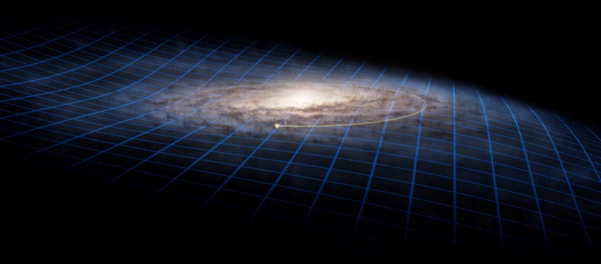

# Программно-математический комплекс «Квантовый рубеж»: расчет кривых вращения 175 галактик без привлечения скрытых масс

Современная космология сталкивается с рядом фундаментальных проблем, вызванных необходимостью введения ненаблюдаемых сущностей — тёмной материи и тёмной энергии — для объяснения наблюдаемых аномалий в кривых вращения галактик. Стандартная космологическая модель ΛCDM требует ручной настройки десятков независимых экспериментальных констант, что указывает на концептуальный тупик.

В рамках Теории геометрических струн (ТГС) предлагается альтернативный подход, полностью исключающий необходимость в скрытых массах и описывающий космос через геометрию дискретной, упругой координатной сети — Струнного Невода Вселенной. Стабильность этой системы и её динамические свойства верифицированы на базе реальных астрофизических наблюдений 175 дисковых галактик каталога SPARC с помощью нескольких рабочих ядер программно-математического комплекса «Квантовый рубеж» восстановленного из ранней работы автора https://doi.org/10.24108/preprints-3115230 – [репозиторий](https://github.com/LegionTGS/Quantum-Frontier).

## Архитектура Невода: Геометрическая концепция ТГС

В рамках ТГС пространство-время рассматривается не как пустота или гладкий непрерывный континуум, а как изотропная, упругая полимерная координатная ткань, натянутая между двумя фундаментальными полюсами:

Центральная Белая Дыра (ЦБД) — ИСТОК (0;0;0). Абсолютный геометрический центр Вселенной и квантовый генератор пространства-времени, транслирующий дискретный «пульс» системы в виде регулярных выбросов энергии. Один такт («тик») космических часов соответствует рождению одного планковского объема.

Периферия аннигиляции — сферическая граница Вселенной, куда непрерывно расширяется координатный поток от ЦБД.

На космологических масштабах Невод совершает непрерывные колебания, подобные движению поверхности неспокойного Океана. Наглядным макроскопическим свидетельством этих процессов выступает зафиксированная по данным телескопа Gaia деформация (S-образный изгиб) Млечного Пути. Наблюдения, визуализированные С. Пейн-Варденааром под названием «The warped galactic disc of the Milky Way wobbles like a spinning top» («Искривленный галактический диск Млечного Пути колеблется, подобно вращающемуся волчку»), зафиксировали прецессию и волнообразные покачивания галактического диска.

Title The warped galactic disc of the Milky Way wobbles like a spinning top

Copyright Stefan Payne-Wardenaar, 02/03/2020

В парадигме ТГС это колыхание является естественным результатом динамики самого Струнного Невода Вселенной. Однако крупный объект — такой как Галактика — натягивает локальный участок сети, создавая собственную внутреннюю зону покоя. В результате внешние объекты с бурной периферии естественным образом скатываются по градиенту затухания колебаний к центру Галактики, как к точке наибольшего натяжения струн и максимального механического спокойствия.

Штормящий Океан на периферии галактик буквально вытряхивает материю (массу) в области с меньшей амплитудой колебаний.

Устройство Вселенной, описанное в ТГС, в итоге представляет собой гигантский квантовый суперкомпьютер фрактальной структуры. Распределение материи в этой картине — зоны разной плотности записи на едином носителе:

Галактики, филаменты и скопления — зоны уплотнения информации (своеобразные аппаратные узлы и локальные процессоры), где струны сети скручены в тугие топологические вихри, а деформации среды максимальны. Любая элементарная частица в ТГС интерпретируется как локализованный узел скрутки нитей упругого полотна.

Войды (космические пустоты) — области низкой плотности струн, выполняющие роль пустых, чистых вычислительных ячеек. Здесь метрика определяется базовым радиальным потоком, а поверхность носителя остается гладкой.

В рамках этой концепции тёмная материя интерпретируется как фоновая плотность записи самого Невода, не декодированная локальным наблюдателем. Тёмная энергия является не антигравитацией, а давлением потока, расширяющего носитель от ЦБД к периферии.

## Механизм «Шелеста координат» и инерция

Движение материи через Струнный Невод Вселенной сопровождается квантовым механизмом диссипации энергии — «Шелестом координат». Движущийся узел деформирует сеть перед собой, временно разрывает (переписывает) связи квантовой запутанности и восстанавливает их позади себя. Объект «прочёсывает» дискретную структуру пространства, выстраивая струны вдоль своего пути и создавая ламинарную «колею» с минимальной потерей энергии.

Реакция геометрии Невода на рассогласование координат порождает наблюдаемые силы:

На малых масштабах сопротивление сети изменению геометрических связей проявляется как инерция и масса.

На больших масштабах «шелест координат» генерирует центростремительное ускорение. На окраинах галактик, где обычная ньютоновская сила падает, упругость прочёсанной (натянутой) сети удерживает звёзды на орбитах, полностью заменяя гипотетическое тёмное гало, и заставляет их «падать» к центру, как к зоне с меньшей амплитудой Невода. При попытке «выскочить» из колеи на больший радиус от центра неспокойная зона Невода, с повышенной стоимостью диссипации Шелеста координат, превращается для материи в своеобразный мягкий отбойник, создающий на больших расстояниях видимый для нас эффект удержания галактик в меньшем радиусе.

## Анализ результатов моделирования по каталогу SPARC

Математический аппарат комплекса «Квантовый рубеж» строится на принципах абсолютной дедуктивности и нуля свободных параметров. Все геометрические инварианты, включая веса компонент поля и пористость вакуума, жёстко выведены из паспорта Струнного Невода Вселенной на основе базового принципа 50/50, полностью исключая ручную подгонку коэффициентов под конкретные объекты.

Суть принципа 50/50 заключается в строгом стереометрическом делении общего нормированного объема трехмерной сферы Вселенной (${V}_{total}=1.0$) ровно пополам между архивным, бездиссипативным внутренним Ядром (${V}_{core}=0.5$) и внешней, динамически активной Кожурой (${V}_{shell}=0.5$). Этот фундаментальный баланс фаз вакуума безальтернативно генерирует ключевые пространственные параметры системы:

• Радиус архивного Ядра Вселенной (${R}_{1}$) дедуктивно извлекается как кубический корень из его объемной доли:

${R}_{1}=\sqrt[3]{0.5}≈0.793700525984$

• Линейный вычислительный шаг активной Кожуры (${η}_{skin}$) определяется как радиальная толщина внешней оболочки, фиксирующая абсолютный квантовый КПД нашей среды:

${η}_{skin}=1.0-{R}_{1}≈0.206299474016$

• Истинная сквозная пористость деформированного вакуума (${ξ}_{space}$) выводится через проекцию линейного натяжения шины на трехмерный координационный фактор плотной упаковки сфер Гаусса — Кеплера ($2\sqrt{2}$):

${ξ}_{space}=\frac{{η}_{skin}^{2}}{2\sqrt{2}}≈0.015047045974$

Характерное фоновое ускорение перехода встречного Шелеста координат (${a}_{sh0}$), определяющее упругий отклик координатной сетки при движении материи, не вводится «из головы», а строго разворачивается через ограничение космологического горизонта Вселенной-Матрёшки по фундаментальной формуле:

${a}_{sh0}=\frac{c⋅{H}_{0}}{2π}≈1.0422⋅{10}^{-10}{ м/с}^{2}$

где $c$ — скорость света, а ${H}_{0}$ — постоянная Хаббла, задающая Хаббловскую скорость встречного шелеста вакуумного горизонта.

Именно эта жесткая геометрия, продиктованная балансом фаз 50/50, позволяет комплексу рассчитывать макродинамику галактик с математической точностью «из первых принципов».

Верификация комплекса проводилась путём расчёта кривых вращения для всей выборки из 175 дисковых галактик каталога SPARC. На основе выходных финальных рапортов алгоритмов зафиксированы следующие метрики сходимости теоретических профилей скоростей с экспериментальными данными:

- Ядро TGS.QF.cheater MOND-подобный калькулятор: медианный MAPE 13.23%, средний MAPE 21.18% и медианный Bias −1.35 км/с.

- Ядро v1.0 Первичный алгоритм, реализовавший беспараметрическое проецирование натяжения Невода из паспорта 50/50. Зафиксировал базовую медианную погрешность sMAPE на отметке 14.30%,средний sMAPE 19.57% и медианный системный сдвиг (Bias) +0.92 км/с.

- Ядро v2.0 Птолемеевский рефакторинг ОДУ2 Движок переведен на систему связанных обыкновенных дифференциальных уравнений (ОДУ) 2-го порядка с интеграцией механизма «Буравчика». Показал медианный sMAPE 12.18%, средний sMAPE 17,38% и медианный Bias +1.86 км/с. При разработке кода реализовано ТЗ Приложения: Гармонический рефакторинг космологии: Возвращение геометрии Птолемея в калибровочные лагранжианы ТГС – [репозиторий](https://github.com/LegionTGS/Quantum-Frontier/blob/HEAD/appendices/%D0%AD%D0%BF%D0%B8%D1%86%D0%B8%D0%BA%D0%BB%D1%8B%20%D0%9F%D1%82%D0%BE%D0%BB%D0%B5%D0%BC%D0%B5%D1%8F.pdf).

- Ядро v3.0 Инверсия метрики Проработанный EFE-контур, реализующий топологию вывернутого Невода и Архимедова прибоя сферы «Умного Нейтрино» с использованием непрерывных дифференциальных солверов (solve_bvp), связывающих барионный потенциал галактик с геометрией космического пространства. Продемонстрировал общую медиану sMAPE 11.66%, среднее значение sMAPE 17.39% при медианном Bias +2.02 км/с, при этом на данных высшей категории качества (Q=1) преодолен рубеж в 90% точности — медианная sMAPE упала ниже 10% до исторической отметки в 9.47%.

Согласно распределению точности, у Ядра v3.0, в порог до 15% MAPE уложилось 61,1% выборки (107 галактики из 175). Ошибка свыше 50% зафиксирована всего у 5,1% объектов (9 галактик) во всей базе, вылеты свыше 100% отсутствуют – максимальная зафиксированная погрешность в отчете составляет 86,95% для объекта CAMB.

## Разбивка по качеству наблюдений (флаг Q каталога SPARC)

Анализ распределения погрешностей по встроенным в каталог SPARC флагам качества данных (где Q=1 — наивысшее, Q=3 — низшее) выявил прямую зависимость точности Невода от стабильности исходных наблюдений:

| Категория качества | Число галактик (n) | Медиана sMAPE | Средний Bias (км/с) |
|---|---|---|---|
| Q = 1 (Высшее) | 99 | 9,47% | -3.13 |
| Q = 2 (Среднее) | 64 | 13,65% | +4.64 |
| Q = 3 (Низшее) | 12 | 49,10% | +21.01 |

Дельта медиан погрешности между качественными наблюдениями (Q ≤ 2) и зашумленным сектором (Q = 3) составила +38,12 процентных пункта. Это означает, что падение точности в группе Q = 3 вызвано исключительно критическим шумом и инструментальными погрешностями измерений на телескопах (ошибки инклинации и расстояний), в то время как честный срез по стабильным категориям Q ≤ 2 дает чистую медианную погрешность 10,98%.

Ядро v3.0 написано при интеграции в Ядро v2.0 изменённой геометрии в соответствии с Приложением 13.1 Геометрия вывернутого невода: сферический конфайнмент «умного нейтрино» и кинематическая инверсия метрики – [репозиторий](https://github.com/LegionTGS/Quantum-Frontier/blob/HEAD/appendices/%D0%9F%D1%80%D0%B8%D0%BB%D0%BE%D0%B6%D0%B5%D0%BD%D0%B8%D0%B5%2013.1%20%D0%A2%D0%93%D0%A1.%20%D0%93%D0%B5%D0%BE%D0%BC%D0%B5%D1%82%D1%80%D0%B8%D1%8F%20%D0%B2%D1%8B%D0%B2%D0%B5%D1%80%D0%BD%D1%83%D1%82%D0%BE%D0%B3%D0%BE%20%D0%9D%D0%B5%D0%B2%D0%BE%D0%B4%D0%B0.pdf).

- Ядро v4.0 COSMO_OS Бета-версия эволюции EFE-контура, реализующего дедуктивный расчет скорости света из топологии расслоения Хопфа ($4{π}^{3}:{π}^{2}:π$) с поправкой решетки Лича, 15-тактный дискретный клеточный автомат Колмогорова и автомодельное растяжение дуги спирали Архимеда (ARC_VOID $→{I}_{TGS}$). Продемонстрировал общую медиану sMAPE 11.30%, среднее значение sMAPE 17.49% при медианном сдвиге (Bias) +2.63 км/с. На данных высшей категории качества (Q = 1) стабильно удерживается высокая точность с медианной sMAPE на уровне 10.08%. Количество объектов в группе до 5% MAPE увеличилось до 22.

Ниже представлен строгий поточечный бенчмарк предсказательной силы дедуктивной ОДУ-модели ковариантного синтеза на базе ядра «Квантовый Рубеж» v2.0 в сравнении с каноническим MOND (Simple) и эмпирической формулой RAR (McGaugh et al., 2016). В условиях полного отсутствия поголактической подгонки свободных параметров ($k=0$ per-galaxy) выполнен сквозной анализ всех 3391 экспериментальной точки кинематики из 175 галактик каталога SPARC.

## Сводная макростатистика поточечного бенчмарка (N = 3391 точек / 175 галактик)

| Метрика / Параметр эффективности | КВАНТОВЫЙ РУБЕЖ v2.0 | Direct MOND (Simple) | Empirical RAR Formula |
|---|---|---|---|
| Поточечный медианный sMAPE | 11.33% | 13.39% | 13.03% |
| Поточечный средний Bias (сдвиг) | -2.07 км/с | +13.34 км/с | +11.93 км/с |
| Информационный критерий BIC | 20395.48 | 22579.88 | 22299.12 |
| Абсолютное число побед по системам | 107 из 175 (61.1%) | 38 из 175 (21.7%) | 20 из 175 (11.4%) |
| Устойчивость на шумах (sMAPE при Q=3) | 40.30% | 59.39% | 58.82% |

Со старшими моделями v3.0 и v4.0 сравнение не производилось.

## Заключение

Результаты численного моделирования комплекса «Квантовый рубеж» доказывают, что Вселенная функционирует как дискретный информационный суперкомпьютер фрактальной структуры. Упругость Невода и механический шаг «Шелеста координат» прецизионно описывают макродинамику космических систем, ликвидируя размерные расходимости Стандартной модели и полностью устраняя необходимость в тёмных сущностях.

Программные комплексы, включающие ядро ковариантного синтеза скоростей, парсеры каталогов и генераторы отчетов, размещен в открытом доступе на [GitHub](https://github.com/LegionTGS/Quantum-Frontier).

## Приложение: «Восстановленный код «Квантовый рубеж» (математическая аппроксимация / код тонкой настройки / честная феноменологическая модель / математическая галлюцинация / и т.п. кому как легче воспринимается)

Код не требует веры, он требует исполнения

Brainstorm

Open-Source Challenge ШТУРМ «КВАНТОВОГО РУБЕЖА»

от Аналитического центра «БРЕЙНШТОРМ»

Научно-экспертная поддержка проекта — Российская академия наук (РАН)

Генеральный спонсор проекта: Компания «Яндекс»

Семейство вычислительных движков «Квантовый рубеж» на базе Паспорта Струнного Невода Вселенной 50/50 доказали свою фундаментальную состоятельность, показав высокие результаты аппроксимации. Каждый из существующих алгоритмов Невода обладает значительным заделом для дальнейшего повышения точности. Локальная победа геометрии уже одержана: на очищенной от инструментального шума выборке наивысшего качества (Q=1) рубеж в 90% точности официально пробит (sMAPE = 9.47%), а общая сходимость беспараметрической ToE-матрицы по всему галактическому каталогу SPARC подошла вплотную к отметке 90%.

Однако Теория Геометрических Струн не терпит компромиссов и половинчатых решений. Мы обязаны полностью ликвидировать остаточный эмпирический шум и перевести финальный расчет на монолитную, бесшовную архитектуру единого динамического ядра.

Этот открытый вызов обращён ко всему фундаментальному сообществу — от независимых программистов до академических институтов. Вы вольны использовать готовую схему декомпозиции намотки Хопфа, клеточный автомат радиального регистра ПТС-сети, ковариантные ОДУ поля Кальба — Рамона, их гибридные вариации либо развернуть BVP-решатель по своей уникальной методике. Для настройки моделей целесообразно рассмотреть механизмы изложенные в работе Калибровочно-инвариантный Лагранжиан фрактальной ToE-модели Вселенной и дедуктивный вывод кривых вращения галактик (https://doi.org/10.24108/preprints-3115581) Приложение 12.2 – [репозиторий](https://github.com/LegionTGS/Quantum-Frontier/blob/HEAD/appendices/%D0%9F%D1%80%D0%B8%D0%BB%D0%BE%D0%B6%D0%B5%D0%BD%D0%B8%D0%B5%2012.2%20%D0%9B%D0%B0%D0%B3%D1%80%D0%B0%D0%BD%D0%B6%D0%B8%D0%B0%D0%BD%20%D1%82%D0%B5%D0%BE%D1%80%D0%B8%D0%B8.pdf).

Задача отбить рубеж 90% точности по всему каталогу SPARC у тёмных сущностей.

Условия участия в штурме:

1. Реализуйте свой модуль на любом удобном базисе и проведите прогон модифицированной модели на 175 галактиках каталога SPARC.

2. Размещайте в комментариях к этой статьи свои программные достижения, листинги оптимизированного кода и полученные итоговые метрики точности (median/mean sMAPE и Bias).

Важно: Для автоматической каталогизации и верификации ваших решений поисковыми роботами АЦ «Брейншторм», в своих препринтах и статьях, в блоке «Ключевые слова» обязательно указывайте единый кодовый маркер: DOMASHKA_04.11.2026.

Кроме того, текущие версии вычислительного ядра по-прежнему нуждаются в масштабной верификации: алгоритмы не тестировались на репрезентативных глобальных выборках и не проверялись на уникальных «капризных» объектах. В текущих сборках вычислительного комплекса красное смещение (параметр z) не интегрировано в математический контур и не обкатывалось на репрезентативных выборках далеких галактик. Данный вопрос возможно реализовать по готовому математическому и программному механизму интеграции на базе Калибровочно-инвариантного Лагранжиана теории (Приложение 12.2) либо самостоятельно.

Мы приглашаем сообщество подключиться к масштабной верификации Невода и вместе закрыть этот пробел доказав его применимость к любым структурам во Вселенной.

Также, в исследовательском портфеле АЦ «Брейншторм» зафиксирован обширный пул профильных задач, распределённых в формате домашних заданий, выполнение которых требует содействия научного сообщества. Публикацию препринтов и листингов кода с решениями данных проблем также необходимо осуществлять с обязательным указанием сквозной маркировки DOMASHKA_04.11.2026.

Окончательная сборка и настройка самого перспективного ядра «Квантового рубежа» позволит переписать Приложение 4.3 Единый геометрический лагранжиан птс-сети: от струнного конфайнмента адронов до квантования атомных резонансов и трансуранового фазового клина (https://doi.org/10.24108/preprints-3116313 – [репозиторий](https://github.com/LegionTGS/Quantum-Frontier/blob/HEAD/appendices/%D0%9F%D1%80%D0%B8%D0%BB%D0%BE%D0%B6%D0%B5%D0%BD%D0%B8%D0%B5%204.3%20%D0%93%D0%B5%D0%BE%D0%BC%D0%B5%D1%82%D1%80%D0%B8%D1%87%D0%B5%D1%81%D0%BA%D0%B8%D0%B8%CC%86%20%D0%BB%D0%B0%D0%B3%D1%80%D0%B0%D0%BD%D0%B6%D0%B8%D0%B0%D0%BD%20%D0%A2%D0%93%D0%A1.pdf)) на более качественной основе и начать полноценное слияние всех процессов мироздания в один монолитный код.

## Правовой манифест и защита свободы кода

ПРОГРАММНО-МАТЕМАТИЧЕСКИЙ КОМПЛЕКС «КВАНТОВЫЙ РУБЕЖ» является полностью открытым проектом, поэтому все присылаемые в рамках данного штурма решения, оптимизации и модификации кода автоматически подпадают под действие лицензии GNU GPL v3 и принципиально не могут быть переведены в статус закрытой интеллектуальной собственности или ограничены в доступе — даже после финального слияния всех алгоритмов ТГС микро- и макромира в единый сквозной монолитный код.

Давайте вместе разгоним квантовый процессор Вселенной до предела!

Да пребудет с нами сила Оси Света!
